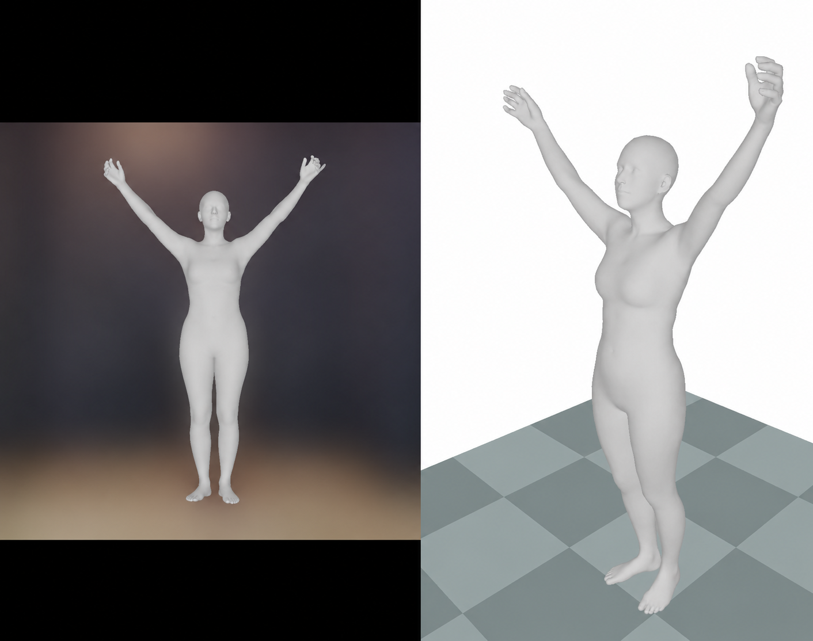
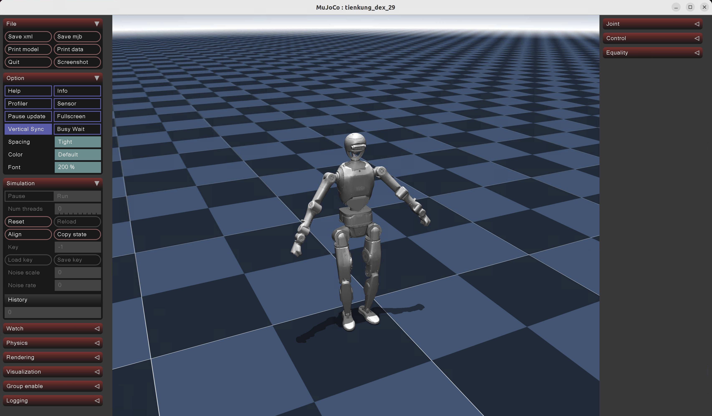
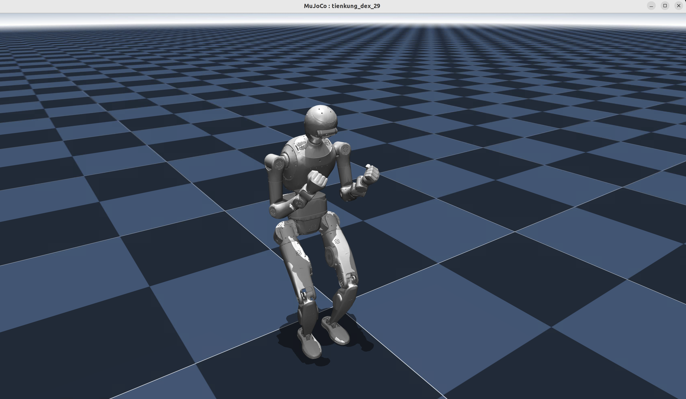
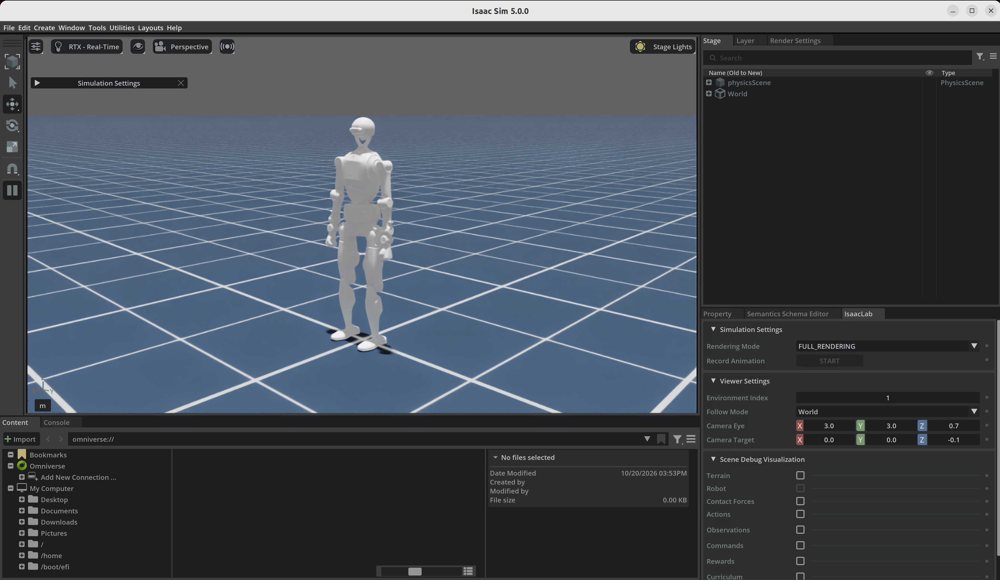
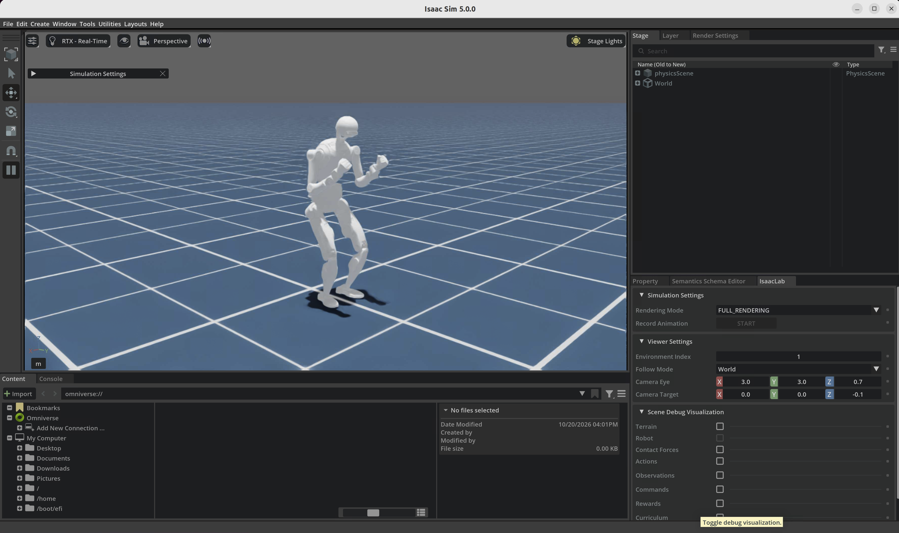
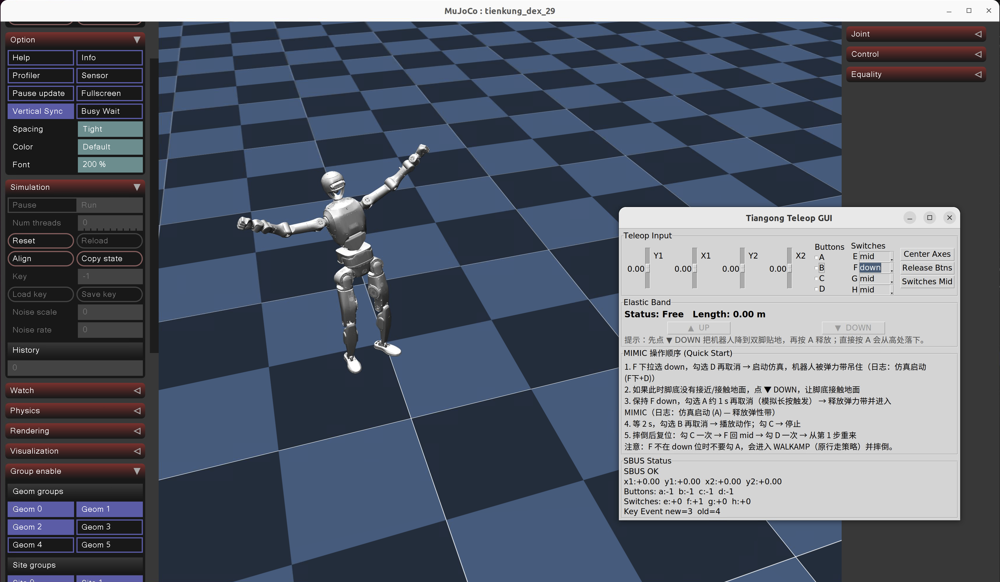

# Dex：视频动作到人形机器人控制

面向天工 Dex 的工程工具链：**MP4 → 人体动作 → 机器人参考动作 → 模仿学习 → Isaac / MuJoCo 仿真 → ROS2 部署**。

本项目由 Open-X-Humanoid 的 [xGMR](https://github.com/Open-X-Humanoid/xGMR)、[xMimic](https://github.com/Open-X-Humanoid/xMimic) 和 [xSIM_MUJOCO](https://github.com/Open-X-Humanoid/xSIM_MUJOCO) 派生整理，使用修正后的本体 URDF，统一模型、数据接口与各阶段运行入口。

## 两个包的分工

| 包 | 负责什么 | 输入 → 输出 |
| --- | --- | --- |
| [Dex-GMR](Dex-GMR/README.md) | 视频处理、人体运动估计、逆运动学重定向 | MP4 / 人体动作 → Dex PKL → 训练 NPZ |
| [Dex-Mimic](Dex-Mimic/README.md) | 参考动作检查、策略训练、播放、导出、打包与部署 | NPZ + 可选预制权重 → PT → ONNX → ROS2 控制 |

```text
MP4 ── GVHMR ── 人体运动参数 ── Dex IK ── PKL
                                          │
                                    重采样 / FK / 过渡
                                          │
                                         NPZ
                                          │
                             Isaac Lab：站立头 / 动作头训练
                                          │
                                 Isaac play + ONNX 导出
                                          │
                            MuJoCo ── ROS2 MuJoCo ── 真机
```

PKL/NPZ 回放用于检查参考动作；运行策略则由神经网络和物理仿真共同产生机器人运动。两者应分别检查。

## 各阶段示意

按流程顺序展示各阶段画面，点击图片查看原图；运行步骤见各阶段标题链接。

| [1. 人体动作估计](Dex-GMR/README.md) | [2. IK 重定向与 PKL 回放](Dex-GMR/README.md) | [3. NPZ 参考动作回放](Dex-Mimic/README.md) |
| --- | --- | --- |
| [](docs/1-GMR.png) | [](docs/2-pkl运行.png) | [](docs/3-npz运行.png) |
| 从视频估计人体运动，为机器人重定向提供输入。 | 将人体动作重定向到 Dex，并回放 PKL 检查姿态。 | 转换为训练用 NPZ 后回放，检查参考动作。 |

| [4. Isaac 站立策略](Dex-Mimic/README.md) | [5. Isaac 动作策略](Dex-Mimic/README.md) | [6. ROS2 + MuJoCo](Dex-Mimic/ros_dex_deploy/README.md) |
| --- | --- | --- |
| [](docs/4-isaacsim-standing.png) | [](docs/5-isaacsim-dance.png) | [](docs/6-ROS2+Mujoco.png) |
| 在 Isaac 中播放站立策略，观察站立表现。 | 在 Isaac 中播放动作策略，检查动作跟踪效果。 | 通过 ROS2 控制链路运行 MuJoCo，使用 Teleop GUI 操作。 |

## 模型与控制配置

- 统一当前 Dex 的 URDF、MJCF、关节名、限位和脚底碰撞，保留当前本体质量与惯性。
- 身体为 **29 个活动关节**，头部两轴固定，保留头部质量；左右肘 yaw、腕 pitch/roll 六轴保持活动，不控制手指。
- 区分 **39 个机器人模型 body** 和 **30 个策略 body 子集**，统一动作数据与观测映射。
- 默认采用 `tg3-armature` 电机配置；导出的 ONNX 携带逐轴 armature，MuJoCo 自动读取。
- 校验模型、URDF、网格、策略和动作文件的版本一致性；自定义部署包由一个 `MIMIC_BUNDLE_DIR` 同时控制检查器、FSM 与仿真节点。
- 提供中文视频名处理、分阶段续跑、预制权重初始化、自动跟随镜头、无限网格地面和 ROS2 Teleop GUI。

关节控制采用以下配置：**23 轴接受策略残差修正，左右前臂旋转及手腕 pitch/roll 共 6 轴由 PD 直接跟踪参考动作**。六轴仍会随参考动作运动。希望全部 29 个身体活动关节都参与策略修正的使用者，可按 [六轴残差调整说明](Dex-Mimic/README.md#joint-control-legacy) 自行调整并重新训练验证。

电机参数来源与数值含义见 [模型与动力学说明](docs/model_and_dynamics.md)。

**Isaac 训练/播放和独立 MuJoCo 使用 50 Hz，ROS 部署主循环与网络推理使用 100 Hz。** 参考动作保持 50 fps；ROS 每帧刷新观测并推理两次，播放速度不变。周期设置见 [部署频率说明](docs/model_and_dynamics.md#为什么部署至少需要-100-hz)。

## 随包权重

`Dex-Mimic/policy/dex/` 中保留：

| 文件 | 用途 |
| --- | --- |
| `wbt_model_46400.pt` | 软件包提供的预制动作跟踪权重，用于加快新动作训练 |
| `standing_baseline.pt` | 适配当前本体的站立基线，用于站立播放、默认演示和站立微调初始化 |

建议从预制动作权重开始训练，约 3000 次迭代后检查效果，再根据跟踪误差、跌倒及起止切换继续训练。迭代数是经验起点。

`LOAD_CKPT` 显式加载权重和兼容的归一化状态，重新开始优化；`RESUME=true` 恢复已有训练。两者不能同时使用。训练脚本不会暗中加载预制权重。

各权重的用途、站立基线 JSON 的作用及新训练权重的保存方式见 [权重目录说明](Dex-Mimic/policy/dex/README.md)。

## 从哪里开始

在项目根目录设置路径，后续示例都使用它：

```bash
export DEX_ROOT="$(pwd)"
```

1. 按 [Dex-GMR 安装与视频流程](Dex-GMR/README.md) 准备 GMR、GVHMR 环境及人体资源，生成动作。
2. 按 [Dex-Mimic 训练与导出](Dex-Mimic/README.md) 加载预制权重训练，选择实际 checkpoint 播放、导出。
3. 按 [ROS2 仿真与部署](Dex-Mimic/ros_dex_deploy/README.md) 检查默认站立演示，或加载自己打包的新动作。

日常视频转换使用 `--ik-recovery table-retry`：先完整约束求解，无解再放宽重试。省略该参数时，代码默认是 `strict`（无解就退出）。各模式、约束范围和检查要求见 [IK 模式说明](Dex-GMR/README.md#ik-no-solution)。

各阶段环境独立：

| 阶段 | 系统 | Python | 关键依赖 | GPU |
| --- | --- | --- | --- | --- |
| GVHMR 人体预测 | Linux | 3.10 | Torch 2.3.0+cu121、PyTorch3D | **必需** NVIDIA |
| IK / PKL / 离线 MuJoCo | Linux / macOS | ≥3.11 | MuJoCo 3.10.0、Mink 1.3.0、SMPL-X 0.1.28、Torch ≥2.7 | 可选，CPU 可跑 |
| Mimic 离线转换与检查 | Linux / macOS | 3.11 | `requirements-offline.txt`（MuJoCo + ONNX Runtime） | 不需要 |
| Isaac 训练 / 播放 / 导出 | **Ubuntu 22.04** | 3.11 | Isaac Lab 2.2.0、Isaac Sim 5.1、Torch 2.7.0、RSL-RL 2.3.3 | **必需** NVIDIA |
| ROS2 MuJoCo / 真机 | Ubuntu 22.04 或 24.04 | 3.10 / 3.12 | Humble 或 Jazzy、MuJoCo、ONNX Runtime、Tk | 不需要 |

GVHMR 通过 `GVHMR_PYTHON` 调用，与 GMR、Isaac 三套环境互不混用；各阶段的安装命令见对应子包 README。


已配置 ROS2 环境时，默认站立演示的入口为：

```bash
cd "$DEX_ROOT/Dex-Mimic/ros_dex_deploy"
bash run_sim.sh
```

默认包只包含站立参考，两个头均来自站立基线，**按 B 不会播放舞蹈**。新动作必须先训练、导出、打包，再显式选择自己的包。

GUI 顺序：F=`down` → 勾 D 后取消 → 用 DOWN 降至脚底贴地 → 保持 F=`down`，**勾 A 约 1 s 再取消（长按触发）**。日志出现进入 `MIMIC` 才表示站立策略正在运行；`MIMICDEFAULT` 是准备阶段的 PD 姿态保持。C 停止。

## 目录与打包

```text
LICENSE                         # 原创部分 BSD-3-Clause
THIRD_PARTY_NOTICES.md           # 第三方来源与适用许可
licenses/                       # 完整许可文本
README.md                       # 总览
docs/                           # 模型、动力学、来源说明与免责声明
tools/                          # 只读发行检查及打包
Dex-GMR/                        # 视频与动作重定向
Dex-Mimic/                      # 训练、仿真与部署
```

发行包包含两个功能包、机器人资产、预制权重、默认站立演示及回归测试源码。打包会携带 `THIRD_PARTY_NOTICES.md` 和 `licenses/` 等许可文件，并排除 `Dex-Mimic/outputs/`。用户视频和中间数据默认不包含在内，可通过 `--include-data` 选择携带。

```bash
cd "$DEX_ROOT"
python tools/check_release.py
python tools/release.py --output /tmp/dex-pipeline-release.tar.gz
# 需要同时携带本地 GMR 数据时追加 --include-data
```

打包不包含 venv、Git 元数据、ROS 构建目录或训练日志，同时生成文件 SHA256 清单。第三方人体模型参数不随源码发行，请按 GMR 安装说明准备。

## 使用范围

默认演示为站立策略，持续运行存在水平漂移。新动作需使用自己的参考数据训练，并根据跟踪误差、跌倒情况及起止切换效果选择 checkpoint。参考动作回放成功不代表物理策略已经收敛。

## 免责声明

运行真机前请阅读[使用许可与安全说明](docs/DISCLAIMER.md)（[PDF](docs/机器人运控框架免责声明.pdf)），准备急停和防跌落措施，并先完成仿真测试。软件按“现状”提供。

## 来源与许可

本项目基于 [xGMR](https://github.com/Open-X-Humanoid/xGMR)、[GMR](https://github.com/YanjieZe/GMR)、[xMimic](https://github.com/Open-X-Humanoid/xMimic) 和 [xSIM_MUJOCO](https://github.com/Open-X-Humanoid/xSIM_MUJOCO)，并使用 Isaac Lab、MuJoCo、Mink 等工具。原创部分采用 [BSD-3-Clause](LICENSE)，第三方代码保留原许可，见 [THIRD_PARTY_NOTICES.md](THIRD_PARTY_NOTICES.md)。

视频人体预测使用 [GVHMR](https://github.com/zju3dv/GVHMR)，人体重建使用 [SMPL-X](https://smpl-x.is.tue.mpg.de/)。两者需按官方许可另行获取；商业使用需取得相应授权。使用 Ubisoft La Forge 的 LAFAN1 数据时，遵守其 [CC BY-NC-ND 4.0 许可](https://github.com/ubisoft/ubisoft-laforge-animation-dataset/blob/master/license.txt)。论文引用和许可全文入口见第三方说明。
